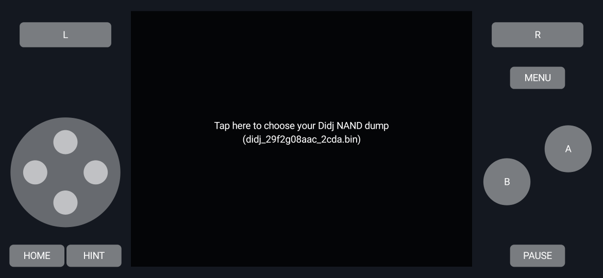
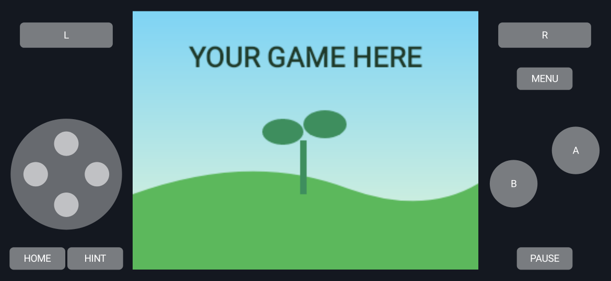
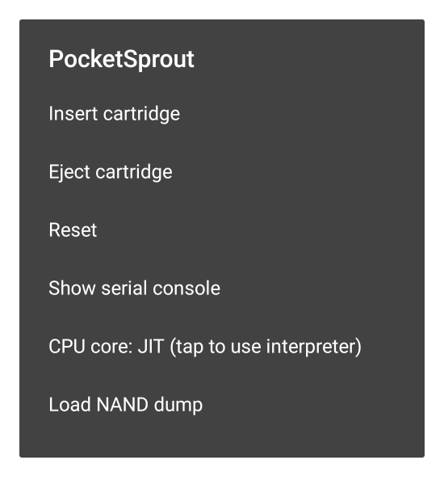

# PocketSprout

An Android emulator for the **LeapFrog Didj** (2008) handheld, built as full hardware emulation
of the LF1000 (MagicEyes Pollux) system-on-chip. It boots the Didj's own firmware from a NAND dump
of your console.

> PocketSprout is an independent fan project. It is not affiliated with, endorsed by or connected
> to LeapFrog Enterprises or any game publisher. "LeapFrog" and "Didj" are trademarks of their
> respective owners and are used here only to say which hardware the emulator recreates.
> **No firmware, BIOS or games are included.** Use it only with dumps of a console and cartridges you own.

## Status

| Part | State |
|---|---|
| ARM926EJ-S CPU (ARMv5TE, ARM + Thumb, CP15 MMU) | Working. Fuzz-tested against Unicorn's ARM926 |
| NAND boot: real LeapFrog bootloader → Linux 2.6.20 kernel | Working |
| Root filesystem, UBI "Brio" partition, LeapFrog app stack | Working |
| Interrupts, timers, GPIO buttons, UART console, RTC, ADC, SPI, DMA | Working (basic) |
| Display: MLC 2D RGB layers | Working: health warning + LeapFrog copyright screens render |
| Audio | PCM sent to the audio block is captured and played (untested on device) |
| 3D graphics (OpenGL ES) | **Working via HLE.** Calls into LeapFrog's `libopengles_lite.so` are trapped and run by a built-in OpenGL ES 1.1 software renderer (`gles.cpp`); the Didj menus render |
| Cartridges | **Working.** FAT cart images (e.g. `NLR` inside a cart zip) are wrapped in UBI on a virtual cart NAND chip (`cart.cpp`); raw cart NAND dumps also load. Didji Racing: Tiki Tropics boots and plays |
| Serial console | UART with TX interrupts, so userspace logging works (it used to block games) |
| Speed | ARM64 JIT (default on 64-bit phones): about 4.6× fewer host instructions than the interpreter on boot. MENU → CPU core switches back to the interpreter for troubleshooting |

## Getting started

You need a NAND dump of your own Didj (its firmware chip) and dumps of your own cartridges.
None are included, and PocketSprout can't run without them.

**1. Install.** Download the APK from the latest build (GitHub **Actions** → *Build* → artifact
`PocketSprout-apk`) and open it on your phone.

**2. Load your NAND dump.** On first launch, tap the screen and choose your dump
(`didj_29f2g08aac_2cda.bin`, 276,824,064 bytes = 256 MB + spare area). It's copied into the app's
storage, so you only do this once.

**3. Play.** The Didj boots its own menus. The on-screen D-pad, A/B, L/R, HOME, HINT and PAUSE
work like the real buttons, and gamepads and keyboards work too.

**4. Insert a cartridge.** Tap **MENU → Insert cartridge** and pick the cart zip or image. The
Didj restarts with it inserted and the game appears under *My Games*. It stays inserted until you
choose *Eject cartridge*.

The MENU also has **Reset**, **Show serial console** (the Linux boot log, useful for bug reports)
and the **CPU core** switch: the fast JIT is the default on 64-bit phones, and the interpreter is
there for troubleshooting.

NAND writes (profiles, settings) are saved back to the app's copy whenever the app is paused.

*The screenshots are rendered from the app's own code off-device; the picture on the screen is a
placeholder drawing, not the Didj's firmware or a game.*

## Layout

- `core/src/arm926.*`: CPU interpreter + MMU
- `core/src/jit.*`, `a64emit.h`: ARM→ARM64 dynamic recompiler (block chaining, inline TLB, interpreter fallback); checked against the interpreter by `tests/jit_fuzz.cpp`
- `core/src/hle.*`: tracks where each process maps `libopengles_lite.so`, parses its ELF symbol table and traps `gl*`/`egl*` entry points
- `core/src/gles.*`: OpenGL ES 1.1 + EGL implementation (transform, lighting, clipping, textured rasteriser, blending, fog)
- `core/src/didj.*`: LF1000 system: memory map, NAND chip/controller, IRQ controller, timers,
  GPIO, UART, DMA, SPI, ADC, RTC, MLC/DPC display, GA3D stub
- `app/`: Android frontend (Java + JNI)
- `tools/didjcli.cpp`: desktop test runner (`didjcli nand.bin -f frames -o shot.ppm -k frame:mask -s N`)
- `tests/cpu_fuzz.py`: differential CPU fuzzer against Unicorn

## Credits

- **LeapFrog's GPL kernel sources** for the Didj (LF1000 `mach-lf1000`, `drivers/lf1000`) and the
  **eLinux.org Didj pages**, which document the hardware this emulator recreates.
- **[Unicorn](https://www.unicorn-engine.org)** is used in testing only, as the reference CPU the
  ARM926 core is fuzz-tested against. It isn't part of the app.
- **[Robolectric](https://robolectric.org)** (MIT) renders the tutorial screenshots in tests.
- The ARM CPU core and the OpenGL ES renderer are shared with PocketPenguin, the GP2X emulator.

## AI use

PocketSprout was built with heavy use of AI. Most of its code and documentation was written by
Anthropic's Claude, working from my direction, testing and review. It has been tested on real
firmware and a real cartridge, but it hasn't had the years of use that long-established emulators
have, so please report anything that doesn't work.

## Licence

PocketSprout is free software: you can redistribute it and/or modify it under the terms of the
GNU General Public License as published by the Free Software Foundation, either version 3 of the
License, or (at your option) any later version. It is distributed WITHOUT ANY WARRANTY; see
[LICENSE](LICENSE) for the full text.

Copyright (C) 2026 Hcode91
